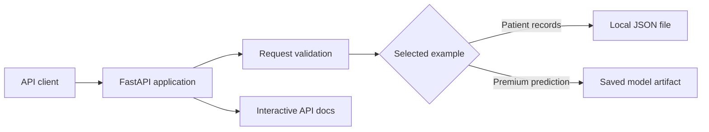

# FastAPI Learning Projects


A Python portfolio repository exploring REST API fundamentals, request validation, local persistence, and serving a saved machine-learning model. It contains two independent FastAPI applications and a set of Pydantic examples.

## Project map

| Path | Purpose |
| --- | --- |
| [main.py](main.py) | Patient-record API backed by a local JSON file |
| [app.py](app.py) | Insurance premium prediction API using the saved `model.pkl` artifact |
| [fastapi_ml_model.ipynb](fastapi_ml_model.ipynb) | Notebook for the model workflow |
| [Pydantic/](Pydantic/) | Validation and computed-field examples |

## Request flow



Start one application at a time. Both expose interactive documentation at `http://127.0.0.1:8000/docs`.

## Run locally

Create and activate a virtual environment, then install the packages used by the examples:

```powershell
python -m venv .venv
.venv\Scripts\Activate.ps1
python -m pip install fastapi "uvicorn[standard]" pydantic pandas scikit-learn
```

On macOS or Linux, activate with `source .venv/bin/activate`.

Start either app from the repository root:

```bash
# Patient-record API
uvicorn main:app --reload

# Or, in a separate run, the model-backed API
uvicorn app:app --reload
```

Visit `http://127.0.0.1:8000/docs` to try the selected API. The prediction app requires `model.pkl`; create or provide the artifact using the project notebook if it is not present in your checkout.

## Safety and scope

- These are learning examples, not production services.
- Do not enter real patient data. The JSON-backed example does not provide production access controls or secure medical-record handling.
- Pickle files can execute code when loaded. Only use model artifacts from trusted sources.
